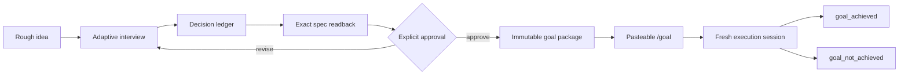

# Intentwright

> **Intent, made executable.**

[](https://github.com/nagyminyo-cmyk/intentwright/actions/workflows/validate.yml)
[](LICENSE)

Intentwright is a pre-execution specification skill for Codex. It turns rough
ideas into decision-complete, approval-bound execution contracts before anyone
starts building. Its adaptive, adversarial interview resolves consequential
ambiguity, freezes the result into an explicitly approved specification, and
generates a short `/goal` command for a fresh execution session.

It is for the moment when:

> “I know what I want in my head, but agents keep turning it into something
> generic.”

Intentwright does not build the project during the interview. Its job is to make
the eventual build goal unusually precise, testable, and difficult to
misinterpret.

## What it changes

A normal prompt often leaves the executor to invent product decisions while it
implements. Intentwright moves those decisions into a deliberate interview:



The interview covers the outcome, users, scope, non-goals, behavior, quality
bar, constraints, preservation rules, authority, failure semantics, validation,
evidence, and completion lifecycle. Domain-specific branches add deeper
questions for software, games, visual design, research, writing, automation,
data, security-sensitive work, and other task types.

## Highlights

- **Adaptive depth:** it keeps asking while a material decision is still open;
  there is no theatrical fixed question count.
- **Exact approval:** the user approves a numbered revision and SHA-256-bound
  execution envelope, not a vague summary.
- **Named specifications:** packages contain files such as
  `goal_spec_game_rebuild_map.md`.
- **Multiple concurrent goals:** separate agents can claim non-overlapping
  write scopes without mixing their specifications.
- **Immutable execution handoff:** a published spec cannot silently drift.
- **Evidence-based completion:** mandatory acceptance criteria require
  criterion-specific evidence.
- **Honest archival:** finished packages move to `goal_achieved`; blocked,
  cancelled, abandoned, or superseded work moves to `goal_not_achieved`.
- **Crash and takeover handling:** exact IDs, claim epochs, heartbeats, terminal
  seals, and recovery rules prevent “just rerun it” ambiguity.

## Install

Requirements:

- Codex with user skills support
- Git
- Python 3.10 or newer (`python` on Windows; normally `python3` on macOS or
  Linux)

### Install from Codex

Enter this in Codex, not in a terminal:

```text
$skill-installer Install Intentwright from https://github.com/nagyminyo-cmyk/intentwright
```

### Manual installation: Windows PowerShell

```powershell
New-Item -ItemType Directory -Force "$HOME\.agents\skills" | Out-Null
git clone https://github.com/nagyminyo-cmyk/intentwright.git "$HOME\.agents\skills\intentwright"
```

### Manual installation: macOS or Linux

```bash
mkdir -p ~/.agents/skills
git clone https://github.com/nagyminyo-cmyk/intentwright.git ~/.agents/skills/intentwright
```

Codex normally detects the new skill automatically. If `$intentwright` does not
appear, start a new session or restart Codex.

If that destination already contains an older manual copy, move or remove that
copy deliberately before cloning. Do not merge two installations.

Intentwright also refuses to adopt lifecycle state created by a differently
identified helper. Finish or retire those packages with the helper that created
them, then start Intentwright in a clean workspace or deliberately cleared goal
root. Never rename sealed packages or their marker files in place.

### Migrating lifecycle schema 1 packages

Intentwright uses lifecycle schema 2. If an earlier helper has an active,
pending, or terminal schema 1 package:

1. keep that exact installed helper and its directory unchanged;
2. finish, archive, recover, or retire the package with that helper;
3. never rename or edit its sealed package, marker files, or generated handoff;
4. install Intentwright separately at `.agents/skills/intentwright`; and
5. begin Intentwright work only in a clean workspace or deliberately cleared
   goal root.

The schema boundary is intentionally fail-closed. A new approval is required
when work must be recreated under Intentwright.

The historical `v1.0.0` tag remains frozen solely so existing schema 1
handoffs can recover the exact helper that created them. Do not update that
checkout to `main` while any of its packages still exist.

## Use

Start a new Codex session in or near the project you want to define:

```text
$intentwright I want to build an amazing multiplayer game
```

Or:

```text
$intentwright Grill me until we have a complete specification for rebuilding the map system.
```

Intentwright will:

1. establish the canonical workspace;
2. assign a visible interview ID;
3. ask the highest-leverage unresolved question;
4. maintain an explicit decision ledger;
5. run adversarial readiness reviews;
6. show the complete specification and approval receipt;
7. wait for the exact approval phrase;
8. publish an isolated package under `goals/goal_pending`;
9. return a `/goal` command to paste into a new session.

The first response should look roughly like:

```text
Intentwright interview started: iwi_...

My current understanding: ...

First foundational question: Is this a brand-new project or a goal for an
existing project?
```

It intentionally asks one foundational branching question at a time. Once the
shape of the task is stable, it may group a few independent detail questions.

## Goal layout

Each project gets one registered goal root, normally `goals`:

```text
goals/
├── goal_pending/
│   └── g_<timestamp>_<specific_slug>_<random>/
│       ├── goal_manifest.json
│       ├── approved_semantic_spec.md
│       ├── goal_spec_<specific_slug>.md
│       ├── execution_prompt.md
│       ├── portable_handoff.md
│       ├── package_seal.json
│       └── status.json
├── goal_achieved/
└── goal_not_achieved/
```

Several goals may remain pending at once. The lifecycle helper prevents
well-behaved agents from claiming overlapping resolved write scopes.

### Keep runtime goal data private by default

The `goals/` tree, `.intentwright-workspace.json`, and
`.goal-forge-workspace.json` compatibility sentinel are local operational
state, not ordinary source files. They can contain:

- complete user specifications and evidence;
- absolute workspace paths;
- host or agent identities;
- live and historical claim tokens;
- terminal reports that may describe failures or sensitive systems.

Unless you deliberately want to review and version that material, add the
following to the **target project's** `.gitignore` before publishing a goal:

```gitignore
/.intentwright-workspace.json
/.goal-forge-workspace.json
/goals/
```

If you selected a custom goal-root name, ignore that exact root instead. Review
already tracked data separately; adding an ignore rule does not remove it from
Git history.

## Update

```powershell
git -C "$HOME\.agents\skills\intentwright" pull --ff-only
```

On macOS or Linux, the same command works with the path
`~/.agents/skills/intentwright`.

If Codex does not detect the update in a new session, restart it.

## Important safety boundary

Intentwright is a coordination and specification system, not an operating-system
sandbox or access-control boundary.

- Declared write scopes are leases enforced among cooperating Intentwright
  executors; they do not remove filesystem permissions.
- Hashes and seals detect accidental or out-of-band changes but are not digital
  signatures against an attacker who can rewrite the package and its seals.
- The skill deliberately requires explicit user approval for publication,
  takeover, cancellation, abandonment, and supersession transitions.
- Review the generated specification before approving it, especially when a
  goal can affect production systems, money, personal data, credentials, or
  external users.

## How it works

- [`SKILL.md`](SKILL.md) contains the interviewer and handoff behavior.
- [`references/interview-playbook.md`](references/interview-playbook.md)
  contains the adaptive question state machine and domain branches.
- [`references/intentwright-package-contract.md`](references/intentwright-package-contract.md)
  defines the exact specification and lifecycle schema.
- [`scripts/intentwright_lifecycle.py`](scripts/intentwright_lifecycle.py) validates approval,
  publication, claims, evidence, archival, recovery, retries, and replacements.

The lifecycle helper uses only the Python standard library. Windows uses
cross-session named mutexes; Unix-like platforms use hardened advisory lock
files.

## Contributing

Bug reports, domain-question improvements, lifecycle tests, and carefully
reasoned contract changes are welcome. See [CONTRIBUTING.md](CONTRIBUTING.md).

For security-sensitive reports, see [SECURITY.md](SECURITY.md).

## License

[MIT](LICENSE)
