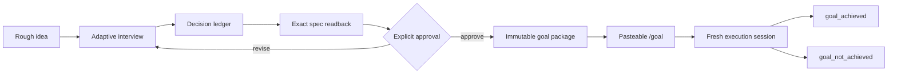

# Intentwright

> **Intent, made executable.**

[](https://github.com/nagyminyo-cmyk/intentwright/actions/workflows/validate.yml)
[](LICENSE)

Intentwright is a pre-execution specification skill for Codex. It turns rough
ideas into decision-complete, approval-bound execution contracts before anyone
starts building. Its adaptive, adversarial interview resolves consequential
ambiguity, freezes the result into an explicitly approved specification, and
generates a short `/goal` command for a fresh execution session.

It is for the moment when:

> “I know what I want in my head, but agents keep turning it into something
> generic.”

Intentwright does not build the project during the interview. Its job is to make
the eventual build goal unusually precise, testable, and difficult to
misinterpret.

## Choose an edition

| Edition | Result | Requirements | Distribution |
| --- | --- | --- | --- |
| **Intentwright for Codex 2.1.0** | Approved specification, sealed local goal package, `/goal` handoff, cooperative execution claims and evidence checks | Codex with `/goal` and skills support, Python 3.10+, local filesystem access | `intentwright-codex-2.1.0.zip` or this repository |
| **Intentwright Spec 1.0.0** | Deep interview, visible decision ledger, explicit specification readback and an approved text handoff | An agent that can load the complete `SKILL.md` in its current conversation | `intentwright-spec-1.0.0-agensi.zip` |

The Spec edition keeps every essential instruction in one `SKILL.md`. It does
not provide local lifecycle packages, hash receipts, execution leases or
machine-verified evidence. It is intended for marketplaces that deliver skills
through an agent connection. Actual acceptance and delivery on Agensi must be
verified with that platform; this repository does not claim an approved listing.

Both editions are MIT licensed. Read the
[Spec edition documentation](https://github.com/nagyminyo-cmyk/intentwright/tree/main/marketplace/intentwright-spec)
for its boundaries. The rest of this README describes the full Codex edition.

## A quick first use

1. Install the full Codex edition using the instructions below.
2. Open Codex in your project and enter:

   ```text
   $intentwright Interview me before adding a weekly task view to this app.
   ```

3. Answer the consequential questions and review the complete specification.
4. Approve only when the exact readback reflects your choices. Copy the returned
   `/goal` command into a fresh Codex session in the same project.

See the [worked example](examples/codex-walkthrough.md) for a concrete interview
and acceptance criteria. The example is illustrative; automated lifecycle
verification comes from the test suite.

## What it changes

A normal prompt often leaves the executor to invent product decisions while it
implements. Intentwright moves those decisions into a deliberate interview:



The interview covers the outcome, users, scope, non-goals, behavior, quality
bar, constraints, preservation rules, authority, failure semantics, validation,
evidence, and completion lifecycle. Domain-specific branches add deeper
questions for software, games, visual design, research, writing, automation,
data, security-sensitive work, and other task types.

## Highlights

- **Adaptive depth:** it keeps asking while a material decision is still open;
  there is no theatrical fixed question count.
- **Exact approval:** the user approves a numbered revision and SHA-256-bound
  execution envelope, not a vague summary.
- **Named specifications:** packages contain files such as
  `goal_spec_game_rebuild_map.md`.
- **Multiple concurrent goals:** separate agents can claim non-overlapping
  write scopes without mixing their specifications.
- **Sealed execution handoff:** cooperating executors verify the published
  specification and reject changes that do not match its stored hashes.
- **Evidence-based completion:** mandatory acceptance criteria require
  criterion-specific evidence.
- **Honest archival:** finished packages move to `goal_achieved`; blocked,
  cancelled, abandoned, or superseded work moves to `goal_not_achieved`.
- **Crash and takeover handling:** exact IDs, claim epochs, heartbeats, terminal
  seals, and recovery rules define which package an executor may resume.

## Install

Requirements:

- Codex with user skills and `/goal` support
- Local filesystem access for the helper and generated packages
- Python 3.10 or newer (`python` on Windows; normally `python3` on macOS or
  Linux)
- Git for repository-based installation; the release ZIP does not require Git

### Install the release ZIP

Download `intentwright-codex-2.1.0.zip` from the
[GitHub releases page](https://github.com/nagyminyo-cmyk/intentwright/releases).
Each published package has a SHA-256 digest in `SHA256SUMS` and a per-file
`MANIFEST.json`. These are integrity checks, not signatures proving authorship.

The ZIP contains one `intentwright/` directory. Extract it into your user skills
directory, normally `~/.agents/skills`, so that
`~/.agents/skills/intentwright/SKILL.md` exists. Do not extract over an existing
installation or merge editions. Keep any helper needed by existing packages
until those packages have been finished, archived, recovered or retired.

For example, after downloading on Windows:

```powershell
New-Item -ItemType Directory -Force "$HOME\.agents\skills" | Out-Null
if (Test-Path -LiteralPath "$HOME\.agents\skills\intentwright") {
    throw "Keep the existing installation; choose a clean installation path."
}
Expand-Archive -LiteralPath "$HOME\Downloads\intentwright-codex-2.1.0.zip" -DestinationPath "$HOME\.agents\skills"
```

### Install from Codex

Enter this in Codex, not in a terminal:

```text
$skill-installer Install Intentwright from https://github.com/nagyminyo-cmyk/intentwright
```

### Manual installation: Windows PowerShell

```powershell
New-Item -ItemType Directory -Force "$HOME\.agents\skills" | Out-Null
git clone https://github.com/nagyminyo-cmyk/intentwright.git "$HOME\.agents\skills\intentwright"
```

### Manual installation: macOS or Linux

```bash
mkdir -p ~/.agents/skills
git clone https://github.com/nagyminyo-cmyk/intentwright.git ~/.agents/skills/intentwright
```

Codex normally detects the new skill automatically. If `$intentwright` does not
appear, start a new session or restart Codex.

If that destination already contains an older manual copy, move or remove that
copy deliberately before cloning. Do not merge two installations.

Intentwright also refuses to adopt lifecycle state created by a differently
identified helper. Finish or retire those packages with the helper that created
them, then start Intentwright in a clean workspace or deliberately cleared goal
root. Never rename sealed packages or their marker files in place.

### Migrating lifecycle schema 1 packages

Intentwright uses lifecycle schema 2. If an earlier helper has an active,
pending, or terminal schema 1 package:

1. keep that exact installed helper and its directory unchanged;
2. finish, archive, recover, or retire the package with that helper;
3. never rename or edit its sealed package, marker files, or generated handoff;
4. install Intentwright separately at `.agents/skills/intentwright`; and
5. begin Intentwright work only in a clean workspace or deliberately cleared
   goal root.

The schema boundary is intentionally fail-closed. A new approval is required
when work must be recreated under Intentwright.

The historical `v1.0.0` tag remains frozen solely so existing schema 1
handoffs can recover the exact helper that created them. Do not update that
checkout to `main` while any of its packages still exist.

## Use

Start a new Codex session in or near the project you want to define:

```text
$intentwright I want to build an amazing multiplayer game
```

Or:

```text
$intentwright Grill me until we have a complete specification for rebuilding the map system.
```

Intentwright will:

1. establish the canonical workspace;
2. assign a visible interview ID;
3. ask the highest-leverage unresolved question;
4. maintain an explicit decision ledger;
5. run adversarial readiness reviews;
6. show the complete specification and approval receipt;
7. wait for the exact approval phrase;
8. publish an isolated package under `goals/goal_pending`;
9. return a `/goal` command to paste into a new session.

The first response should look roughly like:

```text
Intentwright interview started: iwi_...

My current understanding: ...

First foundational question: Is this a brand-new project or a goal for an
existing project?
```

It intentionally asks one foundational branching question at a time. Once the
shape of the task is stable, it may group a few independent detail questions.

## Goal layout

Each project gets one registered goal root, normally `goals`:

```text
goals/
├── goal_pending/
│   └── g_<timestamp>_<specific_slug>_<random>/
│       ├── goal_manifest.json
│       ├── approved_semantic_spec.md
│       ├── goal_spec_<specific_slug>.md
│       ├── execution_prompt.md
│       ├── portable_handoff.md
│       ├── package_seal.json
│       └── status.json
├── goal_achieved/
└── goal_not_achieved/
```

Several goals may remain pending at once. The lifecycle helper prevents
well-behaved agents from claiming overlapping resolved write scopes.

### Keep runtime goal data private by default

The `goals/` tree, `.intentwright-workspace.json`, and
`.goal-forge-workspace.json` compatibility sentinel are local operational
state, not ordinary source files. They can contain:

- complete user specifications and evidence;
- absolute workspace paths;
- host or agent identities;
- live and historical claim tokens;
- terminal reports that may describe failures or sensitive systems.

Unless you deliberately want to review and version that material, add the
following to the **target project's** `.gitignore` before publishing a goal:

```gitignore
/.intentwright-workspace.json
/.goal-forge-workspace.json
/goals/
```

If you selected a custom goal-root name, ignore that exact root instead. Review
already tracked data separately; adding an ignore rule does not remove it from
Git history.

## Update

Before replacing an installed helper, finish existing packages or retain the
helper and directory that their handoffs reference. A ZIP installation is
updated by deliberately replacing it with a checked release archive once it is
safe to do so. Repository installations can use:

```powershell
git -C "$HOME\.agents\skills\intentwright" pull --ff-only
```

On macOS or Linux, the same command works with the path
`~/.agents/skills/intentwright`.

If Codex does not detect the update in a new session, restart it.

## Important safety boundary

Intentwright is a coordination and specification system, not an operating-system
sandbox or access-control boundary.

- Declared write scopes are leases enforced among cooperating Intentwright
  executors; they do not remove filesystem permissions.
- Hashes and seals detect accidental or out-of-band changes but are not digital
  signatures against an attacker who can rewrite the package and its seals.
- The skill deliberately requires explicit user approval for publication,
  takeover, cancellation, abandonment, and supersession transitions.
- Review the generated specification before approving it, especially when a
  goal can affect production systems, money, personal data, credentials, or
  external users.

## How it works

- [`SKILL.md`](SKILL.md) contains the interviewer and handoff behavior.
- [`references/interview-playbook.md`](references/interview-playbook.md)
  contains the adaptive question state machine and domain branches.
- [`references/intentwright-package-contract.md`](references/intentwright-package-contract.md)
  defines the exact specification and lifecycle schema.
- [`scripts/intentwright_lifecycle.py`](scripts/intentwright_lifecycle.py) validates approval,
  publication, claims, evidence, archival, recovery, retries, and replacements.

The lifecycle helper uses only the Python standard library. Windows uses
cross-session named mutexes; Unix-like platforms use hardened advisory lock
files.

## Build and verify release packages

From a source checkout with Python 3.10 or newer:

```text
python -m unittest discover -s tests -v
python scripts/build_release.py --output-dir dist --include-source
```

Use `python3` on platforms where that is the Python launcher. The builder emits:

- `intentwright-codex-2.1.0.zip`, rooted at `intentwright/`, with the complete
  locally executable skill, references, helper, documentation and example;
- `intentwright-spec-1.0.0-agensi.zip`, with `SKILL.md` at the ZIP root for
  marketplace upload, plus its MIT license and supporting documentation;
- `intentwright-source-2.1.0.zip`, with source, tests and release tooling;
- `RELEASES.json` and `SHA256SUMS`, with archive and payload hashes.

Use `--edition codex` or `--edition spec` to build just one install package.
`--include-source` applies to the combined build. An explicit file allowlist
excludes `.git`, `.env` files, caches and runtime goal packages. Review the
included source for secrets before distributing it; the allowlist is not a
secrets scanner. The builder
rejects symlinks and reparse points in selected source trees, checks the version
and required skill files, normalizes text to UTF-8/LF, and fixes ZIP metadata.
The same included source bytes produce the same archive bytes.

Packaging tests extract the full Codex archive and run the included helper's
CLI, verify the upload layout and hashes, and test determinism and rejection
paths. CI builds packages on its existing Windows/macOS/Linux matrix. A
version-matching Git tag also runs the release workflow, which creates a
**draft** GitHub release with reviewed assets. Publishing that draft is a
separate maintainer action.

## Contributing

Bug reports, domain-question improvements, lifecycle tests, and carefully
reasoned contract changes are welcome. See [CONTRIBUTING.md](CONTRIBUTING.md).

For security-sensitive reports, see [SECURITY.md](SECURITY.md).

## License

[MIT](LICENSE)
